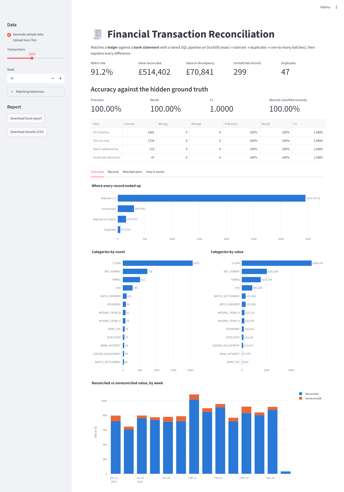
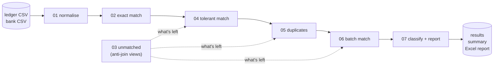

# Financial Transaction Reconciliation Engine

This project reconciles a company's internal **ledger** against its **bank
statement**. It identifies which transactions in the two records belong together,
and explains every difference between them: processing fees, rounding, payment
delays, missing entries, duplicates, and several payments settled as one.

The matching logic is written in **SQL** and runs on **DuckDB**. The project also
includes a test-data generator that records the correct answers, so the engine's
accuracy can be measured precisely, and an interactive **Streamlit** app for
exploring the results.



---

## Results

Measured with [`scripts/benchmark.py`](scripts/benchmark.py) on freshly generated data
(five seeds), scored against each run's hidden ground truth:

| Dataset | Records | Precision | Recall | F1 | Records classified correctly | Duplicates found | Time |
|---|---:|---:|---:|---:|---:|---:|---:|
| 2,000 transactions | ~3,960 | **100.00%** | **99.96%** | **0.9998** | 99.95% | 100% | 0.16 s |
| 6,000 transactions | ~11,870 | **100.00%** | **99.81%** | **0.9990** | 99.89% | 100% | 1.9 s |

- **Every one-to-one pair is recovered**, with no false matches: 24,192 out of 24,192
  across the eight benchmark runs, including every fee, rounding difference,
  settlement delay and reformatted reference.
- The few misses are **batch settlements** where a *different* set of payments in
  the same week happens to sum to the same amount; the engine declines to guess
  rather than match the wrong set.
- **Duplicates** are caught every time.

---

## How it works

Reconciliation is matched in **tiers**, strictest first, so high-confidence matches
are made before the looser passes ever see what is left. Each tier is one `.sql`
file:



| Pass | What it does | The SQL behind it |
|---|---|---|
| [`01_normalise.sql`](sql/01_normalise.sql) | Standardise references (`INV-0398` / `Inv 398` → `INV398`), text and direction | A `MACRO` with `regexp_replace`, `upper`, `CASE` |
| [`02_exact_match.sql`](sql/02_exact_match.sql) | Match on reference + amount + date | `INNER JOIN`; `ROW_NUMBER()` so duplicates pair first-with-first |
| [`03_unmatched.sql`](sql/03_unmatched.sql) | What each source still has unmatched | **Anti-join** (`LEFT JOIN … IS NULL`) as views; `EXCEPT` as a cross-check |
| [`04_tolerant_match.sql`](sql/04_tolerant_match.sql) | Catch processor fees, rounding and settlement delays | **Range join** with a *relative* fee tolerance; Jaro-Winkler for typos; mutual-best ranking with two `ROW_NUMBER()` windows |
| [`05_duplicates.sql`](sql/05_duplicates.sql) | Flag records posted twice | `GROUP BY … HAVING COUNT(*) > 1`, `FIRST_VALUE()` |
| [`06_batch_match.sql`](sql/06_batch_match.sql) | One bank settlement = several ledger payments | **Recursive CTE** searching for sets that sum exactly, pruned by business rules |
| [`07_classify_report.sql`](sql/07_classify_report.sql) | Label every record and summarise | `CASE` labels, `concat_ws`, `FILTER` aggregates, `unnest` |

Every file starts with a comment block explaining what it does and why, so the SQL
reads as a walkthrough. Python stays deliberately thin: it loads the CSVs, runs the
files in order, and hands the results to the report and the demo.

### What the engine finds

| Discrepancy | Example | Found by |
|---|---|---|
| Processor fee | Ledger `£230.89`, bank `£230.00` | Tolerant match → `FEE` |
| Rounding | `£208.49` vs `£208.50` | Tolerant match → `ROUNDING` |
| Settlement delay | Bank posts 1–3 business days later | Tolerant match → `TIMING` |
| Reference format | `INV-398` vs `INV-000398` vs `Inv 398` | Normalisation → `REF_FORMAT` |
| Missing record | In the ledger, never reaches the bank (or vice versa) | Anti-join → `MISSING_FROM_B` / `MISSING_FROM_A` |
| Side-only record | Bank fees and interest; manual ledger adjustments | Anti-join + narrative → `BANK_FEE`, `BANK_INTEREST`, `LEDGER_ADJUSTMENT` |
| Duplicate | The same record posted twice | Duplicate pass → `DUPLICATE` |
| Batch settlement | 2–5 payments arrive as one bank credit for their sum | Batch pass → `BATCH_MEMBER` / `BATCH_SETTLEMENT` |

A matched pair can carry several labels at once, e.g. `FEE;TIMING`.

---

## Quick start

**Prerequisites:** Python 3.11+ and `git`.

```bash
git clone https://github.com/Arbzzz04/financial-reconciliation.git
cd financial-reconciliation
python -m venv .venv
.venv\Scripts\Activate.ps1          # macOS / Linux: source .venv/bin/activate
pip install -r requirements.txt
pip install -e .
```

Then, in order:

```bash
python data/generate_data.py                                   # 1. make sample data
python -m recon data/samples/source_a.csv data/samples/source_b.csv --truth data/samples/truth --out reports/report.xlsx   # 2. reconcile + score
streamlit run app/streamlit_app.py                             # 3. explore it in a browser
pytest                                                         # run the 90 tests
```

`python -m recon` works on any two CSVs with the columns `record_id, reference,
amount, txn_date, currency, description`. Drop `--truth` for real data, which has
no answer key.

### The demo

`streamlit run app/streamlit_app.py` opens the app shown above. You can:

- **generate** a sample dataset (choose its size and seed) or **upload** your own
  ledger and bank CSVs;
- tune the **matching tolerances** (fee size, settlement window, batch size) and see
  the effect immediately;
- explore **charts**: where every record ended up, categories by count and by value,
  and reconciled vs unreconciled value per week;
- filter **every record** by source, status and category;
- **download** an Excel report (summary, categories, records, matched pairs) or a CSV.

With sample data, the app also scores itself against the hidden ground truth.

---

## The data

Real, pre-paired reconciliation datasets are rare, so
[`data/generate_data.py`](data/generate_data.py) builds them: a hidden **base set** of
transactions, from which a ledger and a bank statement are derived with controlled,
configurable discrepancies. The same seed always produces the same data.

```bash
python data/generate_data.py --n 5000 --seed 7
python data/generate_data.py --seed-csv transactions.csv --seed-col amount=Amount
```

| Output (`data/samples/`, git-ignored) | What it is |
|---|---|
| `source_a.csv`, `source_b.csv` | What the engine sees: the ledger and the bank statement |
| `truth/ground_truth_pairs.csv` | The answer key: one row per true `(a, b)` pair |
| `truth/record_labels.csv` | The expected status and category of every record |
| `truth/run_metadata.json` | Config, counts, and the tolerance bounds the engine must cover |

Records are shuffled **before** IDs are assigned, so row order and IDs leak nothing.
With `--seed-csv`, amounts and descriptions are sampled from any real transactions
file (for example a Kaggle dataset); no particular dataset is hard-coded.

---

## Design decisions

- **DuckDB.** Embedded like SQLite (no server), but with full analytical SQL (CTEs,
  window functions, recursive queries) and a real `DECIMAL` type. The SQL transfers
  almost unchanged to Postgres or BigQuery.
- **Money is never a float.** Amounts are `Decimal` in Python and `DECIMAL(18,2)` in
  DuckDB, end to end. A float would turn `0.10 + 0.20` into `0.30000000000000004`.
- **Written contracts.** [`docs/contracts.md`](docs/contracts.md) pins what the generator
  and the SQL must agree on: the reference-normalisation rule (implemented in Python
  *and* SQL, and tested to agree on every reference), the tolerance bounds, and the
  grain of the answer key.
- **Relative tolerances.** A 40p gap is a fee on £100 but suspicious on £5, so the
  fee tolerance is a percentage of the amount plus a small fixed charge.
- **Mutual-best matching.** When a record has several candidates within tolerance,
  only pairs that are each other's *best* candidate are accepted, so one ambiguous
  record can't steal another's match.
- **Fair scoring of duplicates.** A duplicate is a byte-for-byte copy, so the engine
  can't know which copy is "the original". Metrics compare duplicate groups as
  interchangeable rather than penalising an arbitrary choice.

## Limitations

- **Batch matching is a subset-sum search,** which is exponential. Business rules (a
  settlement must say so, its stated item count, a one-week payment run) keep it
  fast, and it's tested up to ~6,000 transactions per run. Larger volumes should be
  reconciled one settlement period at a time.
- **Unmatched records are classified from their narrative** ("ACCOUNT FEE",
  "INTEREST", "Manual adjustment"), which suits this data but would need tuning for a
  real bank's statement formats.
- **The data is synthetic.** That's what makes accuracy measurable, but real data
  will have discrepancy types the generator doesn't produce.

---

## Project structure

```text
financial-reconciliation/
├── sql/                      # the seven reconciliation passes, in order
├── src/recon/
│   ├── normalise.py          # reference normalisation (the contract the SQL mirrors)
│   ├── datagen.py            # synthetic data + ground truth
│   ├── db.py                 # DuckDB connection, typed loading, .sql runner
│   ├── pipeline.py           # Tolerances + run_reconciliation()
│   ├── metrics.py            # precision / recall / F1 vs ground truth
│   ├── report.py             # headline table + Excel / CSV export
│   └── __main__.py           # python -m recon
├── app/streamlit_app.py      # interactive demo
├── data/generate_data.py     # data generator CLI
├── scripts/benchmark.py      # accuracy + speed benchmark
├── docs/contracts.md         # what the generator and SQL agree on
└── tests/                    # 90 tests: every pass, metrics, app, end to end
```

## Development

```bash
pytest                 # 90 tests, ~15 s
ruff check .           # lint (pycodestyle, pyflakes, isort, bugbear, Google docstrings)
ruff format .          # format
```

Conventions: Google-style docstrings and type hints on every public function;
SQL keywords in UPPERCASE, one clause per line, CTEs over nested subqueries, and
meaningful aliases (`ledger`, `bank`); [Conventional Commits](https://www.conventionalcommits.org/).

### Roadmap

- [x] **Phase 1:** repo scaffold, tooling, README
- [x] **Phase 2:** synthetic data generator with hidden ground truth
- [x] **Phase 3:** DuckDB setup and normalisation SQL
- [x] **Phase 4:** exact match and anti-joins
- [x] **Phase 5:** tolerant, duplicate and batch matching
- [x] **Phase 6:** classification, reporting and accuracy metrics
- [x] **Phase 7:** end-to-end tests and accuracy floors
- [x] **Phase 8:** Streamlit demo

## License

[MIT](LICENSE) © 2026 Arbaaz Ali Jaffer
